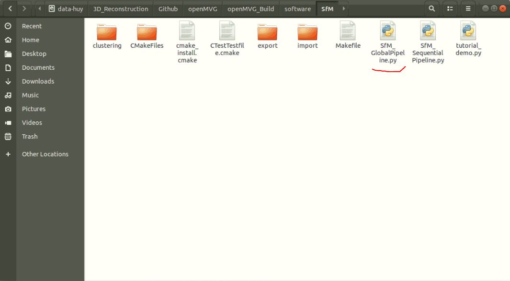
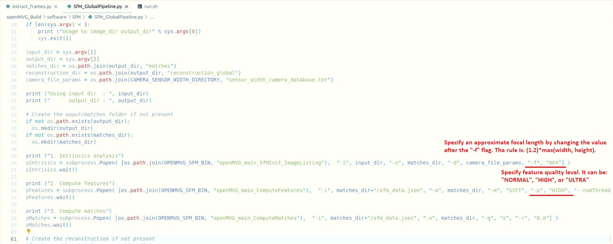
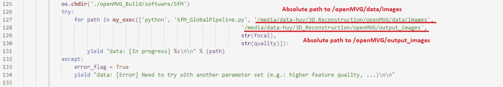
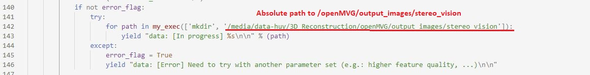
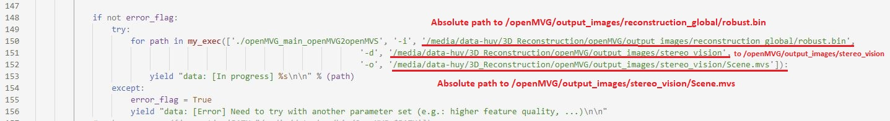
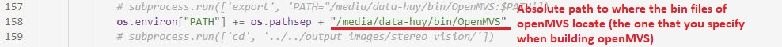
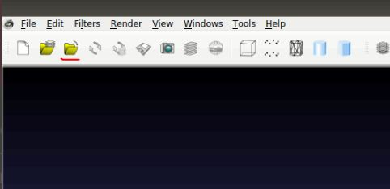
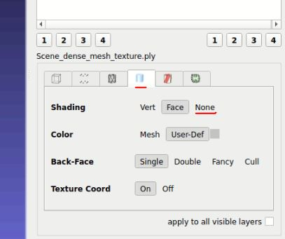
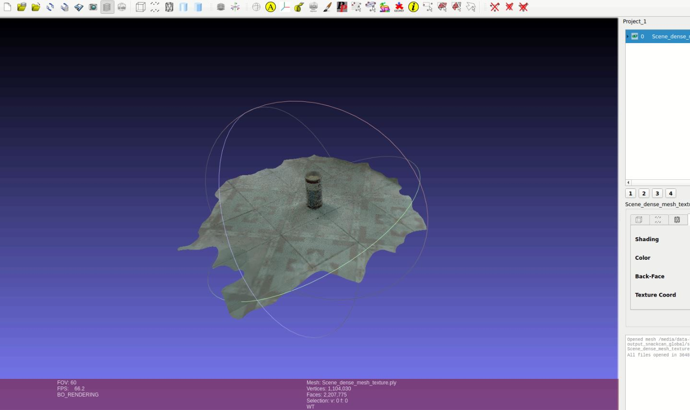

# 3D-Reconstruction


# Table of contents

1. [Overview](#overview)
2. [Tree directory of this project](#tree-directory-of-this-project)
3. [Install required packages and build openMVG](#install-required-packages-and-build-openmvg)
4. [Install required packages and build openMVS](#install-required-packages-and-build-openmvs)
5. [How to run the code to reconstruct 3D model](#how-to-run-the-code-to-reconstruct-3d-model)
6. [Set up the API](#set-up-the-api)
7. [Visualization](#visualization)

# Overview:

To construct a 3D model from images, we use:
- openMVG
- openMVS
- MeshLab (to display a 3D model)

There are 5 main steps:

```Capture images of an object -> Structure from motion (sparse point cloud) -> Densify point cloud -> Reconstruct mesh -> Texture mesh```

- _Capture images of an object:_ you should capture the object from different views.
- _Structure from motion_: given images as input, this stage will output the sparse point cloud of the object. openMVG is responsible for this task.
- _Densify point cloud, Reconstruct mesh and Texture mesh_: after having the sparse point cloud, these 3 tasks are carried out sequentially to produce the final 3D model. openMVS is responsible for these 3 tasks.

The following parts guide you step-by-step to build openMVG, build openMVS, use them for reconstructing a 3D model, set up the API and display the output 3D file (.ply) by MeshLab. All the instructions below are for Ubuntu system and have been tested on version 18.04.

# Tree directory of this project

We also include our built files (for references) in 3 folders: ```/build```, ```/openMVG/openMVG_Build``` and ```/openMVS_Build```. They are not required for build process, so you need to remove them.

```
.
├── api (stores the api files)
├── build ((Remove this folder) stores the output files of the build procedure)
├── demo (stores a demo video)
├── images
├── openMVG
│   ├── data
│   │  ├── extract_frames.py (The file that extracts frames from input video)
│   │  ├── images (stores the images that we use to construst the 3D model in demo)
│   ├── dist
│   ├── docs
│   ├── logo
│   ├── %openMVG_Build% ((Remove this folder) The one built on our machine is also included)
│   │  ├── %Linux-x86_64-RELEASE% (store services helping convert .ply file to .mvs file)
│   │  ├── %software%
│   │  │  ├── %SfM% (stores .py files which serve the task of "Structure from Motion")
│   ├── output
│   │  ├── Scene_dense_mesh_texture.ply (our final reconstructed 3D model to display in MeshLab)
│   ├── %output_images%
│   │  ├── %matches% (stores outputs of the openMVG stage)
│   │  ├── %reconstruction_global% (stores outputs of the openMVG stage)
│   │  ├── %stereo_vision% (stores outputs of the openMVS stage)
│   └── src
├── openMVS
│   ├── apps
│   ├── build
│   ├── docker
│   ├── docs
│   └── libs
│── %openMVS_Build% ((Remove this folder) The one built on our machine is also included)
└── SfM_GlobalPipeline.py (The main file that processes all the steps of Structure from Motion. This file is automatically created in /openMVG/openMVG_Build/software/SfM when building openMVG. However, you need to replace the created file with this one as we have include some new commandline arguments for running with the API (See more on the section "Set up the API" below))
```

The folders specified between ```%%``` are the ones that will be created on the run.

# Required tools

- CMake
- Git
- C/C++ compiler (GCC >= 4.8.1)
- Clang >= 3.3

# Install required packages and build openMVG

Make sure your current working directory is at ```3D-Reconstruction``` (the head folder of this project). Then type:
```sh
cd openMVG
```

Install the required libraries:
```sh
sudo apt-get install libpng-dev libjpeg-dev libtiff-dev libxxf86vm1 libxxf86vm-dev libxi-dev libxrandr-dev
```

Install Graphviz:
```sh
sudo apt-get install graphviz
```

Make sure your current working directory is at ```3D-Reconstruction/openMVG```. Then create and change directory into:
```sh
mkdir openMVG_Build && cd openMVG_Build
```

Configure and build openMVG:
```sh
cmake -DOpenMVG_BUILD_TESTS=ON -DCMAKE_INSTALL_PREFIX:PATH="Path to a chosen folder that will store bin and lib files of openMVG (anywhere that you have permission to manipulate files and folders, E.g. /media/data-huy)" -DCMAKE_BUILD_TYPE=RELEASE ../src/

cmake --build . --target install
```

Run tests using make:
```sh
make test
```

Change directory up one level:
```sh
cd ..
```

# Install required packages and build openMVS

### Dependencies

- Eigen >= 3.2
- OpenCV >= 2.4
- Ceres >= 1.10
- CGAL >= 4.2
- Boost >= 1.56
- VCG
- GLFW

### Install required libraries and build openMVS from source

Install required libraries:

```sh
sudo apt-get -y install git cmake libpng-dev libjpeg-dev libtiff-dev libglu1-mesa-dev
```

Make sure your current working directory is at ```3D-Reconstruction```. Install Eigen:
```sh
git clone https://gitlab.com/libeigen/eigen.git --branch 3.2
mkdir eigen_build && cd eigen_build
cmake . ../eigen
make && sudo make install
cd ..
```

Install Boost:
```sh
sudo apt-get -y install libboost-iostreams-dev libboost-program-options-dev libboost-system-dev libboost-serialization-dev

```

Install OpenCV:
```sh
sudo apt-get -y install libopencv-dev
```

Install CGAL:
```sh
sudo apt-get -y install libcgal-dev libcgal-qt5-dev
```

Make sure your current working directory is at ```3D-Reconstruction```. Install VCGLib:
```sh
git clone https://github.com/cdcseacave/VCG.git vcglib
```

Make sure your current working directory is at ```3D-Reconstruction```. Install Ceres. This is for **Cere 1.14.0**.
- First check the file ```ceres.sh``` and verify if the argument ```-DCMAKE_INSTALL_PREFIX:PATH``` of the ```cmake``` command leading to the right path to which you want to install Ceres (E.g.: /media/data-huy). Usually, there are 2 subfolders (to store output files) will be created in the folder specified by ```-DCMAKE_INSTALL_PREFIX:PATH```: they are ```include``` and ```lib```. (The ```include``` subfolder maybe needs to be first created by us).
- Next, you need to export path to the folder storing Ceres. You should change to the suitable path on your computer. It is the path you set above for ```-DCMAKE_INSTALL_PREFIX:PATH``` with the new ```/include``` part (except the last one):
```sh
export PATH="/media/data-huy/include:$PATH"
export C_INCLUDE_PATH="/media/data-huy/include"
export CPLUS_INCLUDE_PATH="/media/data-huy/include"
export PYTHONPATH="/media/data-huy/include:$PYTHONPATH"
export CERES_ROOT_DIR="/media/data-huy"
```
- Finally, run:
```sh
./ceres.sh
```

Install GLFW3
```sh
sudo apt-get -y install freeglut3-dev libglew-dev libglfw3-dev
```

Make sure your current working directory is at ```3D-Reconstruction```. Build OpenMVS:
```sh
mkdir openMVS_build && cd openMVS_build
cmake . ../openMVS -DCMAKE_INSTALL_PREFIX:PATH="Path to a chosen folder that will store bin and lib files of openMVS (anywhere that you have permission to manipulate files and folders, E.g. /media/data-huy)" -DCMAKE_BUILD_TYPE=Release -DVCG_ROOT="${Absolute path to the vcglib repo that has been cloned above}"
```

Install OpenMVS:
```sh
make -j2 && sudo make install
```

# How to run the code to reconstruct 3D model

_(If you want to deploy the API, ignore this section and come to the next section)_

Assume that captured images are stored in ```data/images```, here are the steps to reconstruct 3D model from these images. You can also look at and use the file ```run.sh``` in which we have included all the required steps listed here.

- __Step 1:__ Make sure your current working directory is at ```3D-Reconstruction/openMVG```. Change directory into:
```sh
cd ./openMVG_Build/software/SfM
```

In this folder, there will be a file named ```SfM_GlobalPipeline.py``` which is mainly responsible for running the whole process of SfM.



Before going to Step 2, you need to change the value of parameter ```-f``` (an approximate focal length) in this file. It requires that all the input images are at the same size, so the value of ```-f``` is calculated by ```1.2*max(width, height)```. Besides, you also want to change the quality level of extracted features. The quality can be: "NORMAL", "HIGH", or "ULTRA". The locations to change is as follows:



- __Step 2:__ Do "Structure from motion" to create the sparse point cloud from images:
```sh
python SfM_GlobalPipeline.py "Absolute path to the folder that stores input images" "Absolute path to the folder that output files are saved at"
```

For example, if images are stored in the ```images``` folder and we want the output files to be saved at ```output_images``` (Note: the output folder will be automatically created). Then the command is as follow: 

```sh 
python SfM_GlobalPipeline.py "/media/data-huy/3D_Reconstruction/openMVG/data/images" "/media/data-huy/3D_Reconstruction/openMVG/output_images"
```

- __Step 3:__ Change directory back to ```3D-Reconstruction/openMVG/openMVG_Build```:
```sh
cd ../..
```

- __Step 4:__ Make sure your current working directory is at ```3D-Reconstruction/openMVG/openMVG_Build```. Change directory into ```Linux-x86_64-RELEASE```:
```sh
cd Linux-x86_64-RELEASE/
```

- __Step 5:__ Convert the output file ```sfm_data.bin``` in the folder ```output_images/reconstruction_global``` into an `.mvs` file that can be used by openMVS:
```sh
./openMVG_main_openMVG2openMVS -i "Absolute path to the sfm_data.bin" -d "Absolute path to the output folder for openMVS. You should create a subfolder named 'stereo_vision' in the previous output folder 'output_images'" -o "Name of the output '.mvs' file. However, you should put the whole path like in '-d' before the name"
```

For example:
```sh
./openMVG_main_openMVG2openMVS -i "/media/data-huy/3D_Reconstruction/openMVG/output_images/reconstruction_global/sfm_data.bin" -d "/media/data-huy/3D_Reconstruction/openMVG/output_images/stereo_vision" -o "/media/data-huy/3D_Reconstruction/openMVG/output_images/stereo_vision/Scene.mvs"
```

- __Step 6:__ Now that you have had the file ```Scene.mvs``` from openMVG, let's turn to openMVS. Firstly, need to export the path to where the bin files of openMVS locate (as specified in the flag ```-DCMAKE_INSTALL_PREFIX:PATH``` when building). For recognizing, there are some files in this folder such as ```DensifyPointCloud```, ```ReconstructMesh```, ```Viewer```, ... : 
```sh
export PATH="Absolute path to where the bin files of openMVS locate:$PATH"
```

For example:
```sh
export PATH="/media/data-huy/bin/OpenMVS:$PATH"
```

- __Step 7:__ Make sure your current working directory is at ```3D-Reconstruction/openMVG```. Change directory to the place where Scene.mvs is previously created:
```sh
cd output_images/stereo_vision/
```

- __Step 8:__ Densify point cloud. When complete, this command will output a file ```Scene_dense.mvs```:
```sh
DensifyPointCloud Scene.mvs
```

- __Step 9:__ Reconstruct mesh from dense point cloud. When complete, this command will output a file ```Scene_dense_mesh.mvs```:
```sh
ReconstructMesh Scene_dense.mvs
```

- __Step 10:__ Texture mesh. Wait until it finishes. When complete, we will have a final 3D model file ```Scene_dense_mesh_texture.ply```. The flag ```resolution-level``` can be 1, 2 or 3. The lower it is, the better the quality of the reconstructed model, and also the more time this command needs to complete:
```sh
TextureMesh Scene_dense_mesh.mvs --resolution-level=2
```

# Set up the API

- The API is built on Flask, so you need to install:

```sh
pip install opencv-python
pip install Flask
pip install Flask-Session
pip install celery
pip install redis
pip install flower
sudo apt-get install redis-server
```

- Next, you need to export the ```PYTHONPATH``` so that the ```/openMVG/openMVG_Build/data/extract_frames.py``` can be found.

```sh
export PYTHONPATH=$PYTHONPATH:<Absolute path to the "data" folder storing extract_frames.py>
```

For example:

```sh
export PYTHONPATH=$PYTHONPATH:/media/data-huy/3D_Reconstruction/Github/openMVG/data
```

For the API to work, you also need to replace the current file ```/openMVG/openMVG_Build/software/SfM/SfM_GlobalPipeline.py```(one of the output file after you build openMVG) with the file ```/SfM_GlobalPipeline.py``` from the root of this project. We have added some command line arguments so it can work with the API. Besides, you have to change 2 path variables in this new file: ```OPENMVG_SFM_BIN``` and ```CAMERA_SENSOR_WIDTH_DIRECTORY```. Assign them with the values in your old file. 

One more thing to do is change some paths in the function ```process_3d``` in the file ```/api/app.py```:

1/ Change the underlined paths to suitable ones on your machine.


2/ Change the underlined path to suitable ones on your machine.


3/ Change the underlined paths to suitable ones on your machine.


4/ Change the underlined path to suitable ones on your machine. To know more about how to change this, you can read at **Step 6** of the section "How to run the code to reconstruct 3D model" and you need to remember the place you choose to build openMVS as specified in the section "Install required libraries and build openMVS from source".


**Note:** In local, we run the ```python app.py``` when being in ```/3D-Reconstruction/api```.

- API endpoint to upload and reconstruct 3D model

```sh
endpoint URL: `/`
method: POST
parameters:
- `file`: video file
- `frame_extraction`: STRING (type of frame extraction), value is 'direct_number', 'interleaved_number' or 'whole_video'
- `num_frames`: INT (the number of extracted frames), value from 1-50
- `interleave`: INT (the number of interleaved frames), value from 1-15
- `feat`:  STRING (feature quality), value is 'NORMAL', 'HIGH' or 'ULTRA'
- `res`: INT (resolution scale), value from 1-3
```

- [Deploying a Flask application to Elastic Beanstalk](https://docs.aws.amazon.com/elasticbeanstalk/latest/dg/create-deploy-python-flask.html)

# Visualization

The `.ply` file can be visualized by using MeshLab.

You can download the ```Linux AppImage``` at [MeshLab page](https://www.meshlab.net/).

Then, use ```chmod +x "the downloaded file"``` to change the access permissions of the downloaded file and you can open it to use MeshLab right away without needing to install any required packages.

In the MeshLab interface:

- Use this button to import the ```.ply``` file:



- It may take a while to finish loading a large 3D model. When complete, on the right of the interface, you will see a ```Shading``` option like this. Click on ```None```



- Now, you can use left mouse to rotate the reconstructed 3D model to view different sides of the object.




# The end