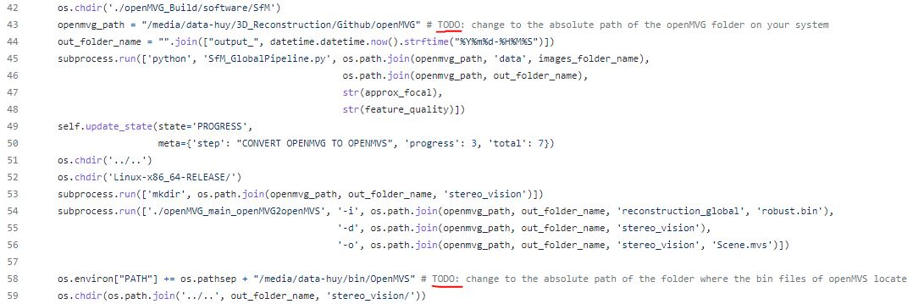

# Web API

There are 3 app files:

- ```app.py```: a full API with progress for 3D reconstruction displayed directly on the web page. It has 2 buttons: "Download output file" and "Reconstruct another 3D model".
- ```app_noprogress.py```: an API which returns the output zip file to download after the reconstruction completes (this condition is required by ShadesOfThings) and shows no progress on the web page.
- ```app_sot.py```: a modified version of ```app_noprogress.py``` which is succesfully used on the machine of ShadesOfThings. There are some small modifications for suitable with their settings.
- ```app_multi.py``` (works along with folder ```proj3d```): an API that runs 3D reconstruction processes as background jobs.

## Required packages/libraries

It is necessary to activate the conda virtual environment (the one that you used in the previous version of the application).

Use the commands below to install packages/libraries:

```sh
pip install -r requirements
sudo apt-get install redis-server
```

## Multi-threading application

- Step 1: First, you need to replace the old ```api``` folder with this ```api``` folder on your system. And you also need to replace the ```extract_frames.py``` in the folder ```/openMVG/data```.

- Step 2: In ```/api/proj3d/tasks.py```, update the paths of 2 TODO lines: line 43 and line 58.

	

	- Line 43: change to the absolute path of the ```/openMVG``` folder on your system.

	- Line 58: change to the absolute path of the folder where the bin files of openMVS locate (the one that you specify when building openMVS). For recognizing, there are some files in that folder such as ```DensifyPointCloud```, ```ReconstructMesh```, ```Viewer```, ...


- Step 3: Next, you need to export the ```PYTHONPATH``` so that the ```/openMVG/openMVG_Build/data/extract_frames.py``` can be found.

	```sh
	export PYTHONPATH=$PYTHONPATH:<Absolute path to the "data" folder storing extract_frames.py>
	```

  - For example:

	```sh
	export PYTHONPATH=$PYTHONPATH:/media/data-huy/3D_Reconstruction/Github/openMVG/data
	```

- Step 4: To conduct a multi-threading run, we need 3 terminals (or 3 tabs in a terminal) which run simultaneously:

  - Change the working directory of each terminal to the ```api``` folder.

  - Terminal 1: for running multiple wokers (in daemon). The number of workers is set after the word "start". Here, we set 5 workers. The values for 2 arguments ```--pidfile``` and ```--logfile``` need to be set again to suit your system. 
    - ```--pidfile``` should have end pattern like this ```var/run/celery/%n.pid```.
    - ```--logfile``` should have end pattern like this ```var/log/celery/%n%I.log```

	```sh
	celery multi start 5 -A proj3d -l INFO --pidfile=/media/data-huy/var/run/celery/%n.pid --logfile=/media/data-huy/var/log/celery/%n%I.log
	```


  - Terminal 2: for running the Flask app.

	```sh
	python app_multi.py
	```

  - Terminal 3: for visualizing the workers

	```sh
	celery -A proj3d flower
	```

- Step 5: After having the 3 terminals, then you can open the web application (according the terminal 2) and try reconstructing 3d models. Moreover, you can also monitor the workers (Which workers do tasks? Which tasks are in process? Whether a task succeeds or fails? ...) by the host produced in the terminal 3.

- Remember to stop the workers after using by this command (the ```--pidfile``` and ```--logfile``` must be set the same as above):
	```sh
	celery multi stop 5 -A proj3d -l INFO --pidfile=/media/data-huy/var/run/celery/%n.pid --logfile=/media/data-huy/var/log/celery/%n%I.log
	```